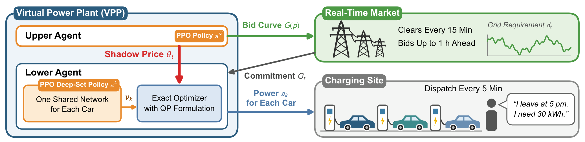

# FlexBid

FlexBid is a simulator of a virtual power plant (VPP) built from bidirectional electric-vehicle (EV) chargers. The VPP sells the flexibility of its charging in a real-time electricity market. It makes decisions on two timescales. Every 15 minutes it submits a bid curve and is committed to a quantity. Every 5 minutes it splits that commitment across the connected vehicles. The package contains the simulator, the rule-based and model-predictive baselines, and the code that trains hierarchical reinforcement-learning (RL) policies for both levels.

<p align="center">
  
</p>

*Overview of the hierarchy. The upper agent submits a bid curve $G(p)$ to the market and sends the shadow price $\theta_t$ to the lower agent. One deep-set policy, shared by every vehicle, gives each vehicle a score $\nu_k$. An exact quadratic program turns the scores, the price and the commitment $G_t$ into each vehicle's power $a_k$.*

**Contents.** [Problem formulation](#problem-formulation) · [Policies](#policies) · [Installation](#installation) · [Usage](#usage) · [Tests](#tests) · [Data](#data) · [License](#license)

---

## Problem formulation

### The fleet

The VPP operates $M$ chargers. Chargers are rated 50, 100 or 150 kW, and discharge is limited to half the rating. Four chargers form a station that shares a DC bus of rating $B = 250$ kW. Vehicles arrive and leave at random, with more arrivals in the morning and the evening. On arrival, the driver states a departure time and requests the energy needed to reach a target state of charge of 90 %. This fixes a baseline plan $b_k$, the constant power that delivers the request by a fraction $f$ of the stated stay. The VPP sells deviations from these plans.

The VPP observes each vehicle's state of charge, energy owed $e_k$, stated time left $T_k$, pack size $E_k$, and the charge and discharge limits its battery reports. It does not observe the cell temperature, the polarization, the true wear rate, or the true departure time. Each driver has a hidden type, on time, early or late, so the true departure may differ from the stated one.

### The market

Every $T_m = 15$ minutes the market clears a requirement $d_t$ against the bid curves of the VPP and three rival aggregators. The requirement follows CAISO net-load days and responds to price, so the VPP is a price maker. The clearing price $p^\ast_t$ is the price at which the bid curves sum to the price-responsive requirement. The VPP does not observe $d_t$ when it bids. It sees only the requirements of intervals already delivered.

The VPP bids a logistic curve:

$$
G(p) = -\zeta^H_t H_t + \left(\zeta^Q_t Q_t + \zeta^H_t H_t\right)\,\sigma\!\left(\beta_t\,(p - p^0_t)\right)
$$

| symbol | meaning | units |
|---|---|---|
| $G(p)$ | flexibility delivered at price $p$; positive means the fleet charges less than its plans | kW |
| $Q_t$, $H_t$ | the most the fleet can reduce and the most it can increase its charging over the interval | kW |
| $\zeta^Q_t$, $\zeta^H_t$ | the offered shares of $Q_t$ and $H_t$ | — |
| $p^0_t$ | anchor price, where the curve is steepest, measured from the last clearing price | price units |
| $\beta_t$ | steepness of the curve | 1 per price unit |
| $\sigma$ | the logistic function | — |

The VPP is then committed to $G_t = G(p^\ast_t)$ and is paid $p^\ast_t G_t$ for the interval. One price unit is worth 0.45 \$/kWh.

**Bid lead.** Real-time markets close a bid some time before delivery. With a bid lead of $L$ intervals, the bid submitted at interval $t$ is cleared at once against the requirement of interval $t+L$, and the commitment delivered at $t$ was fixed at $t-L$. The first $L$ intervals of an episode carry no commitment. The market preset `base` has no lead. The market preset `lead` takes a lead of 0, 15, 30 or 60 minutes, that is, $L \in \{0, 1, 2, 4\}$.

### The lower decision process: dispatch

Each interval has $K = 3$ sub-steps of $T_d = 5$ minutes. At each sub-step $\tau$ the dispatch policy observes 13 features $\xi_k$ of every connected vehicle and 9 fleet-level quantities $o^g_\tau$: the commitment, the two ends of the offered curve, the clearing price, the time of day, the sub-step index, the share of chargers occupied and the time elapsed in the episode. Its action is a vector of scores $\nu \in \mathbb{R}^M$, one per charger. A quadratic program (QP) turns the scores into powers:

$$
a^\ast = \arg\min_{a \in \mathcal{A}_\tau} \sum_k \Big( \alpha_k |a_k| + \rho_k a_k^2 - \kappa\,(\nu_k + \theta_t w_k)\, a_k \Big)
\quad \text{s.t.} \quad \sum_k (b_k - a_k) = G_t
$$

| symbol | meaning | units |
|---|---|---|
| $a_k$ | power of vehicle $k$, negative when discharging | kW |
| $\mathcal{A}_\tau$ | powers that respect each vehicle's reported limits, keep its state of charge in range, keep it able to reach its target by the stated departure, and respect every station bus | — |
| $\alpha_k$, $\rho_k$ | linear and quadratic cycle-wear cost of one sub-step, from a semi-empirical aging model (Schmalstieg et al., 2014) | \$/kW, \$/kW² |
| $\kappa$ | scale from score to money, $10^{-2}$ | \$/kW per sub-step per score unit |
| $\nu_k$ | the dispatch policy's score for vehicle $k$ | score units |
| $\theta_t$ | the message from the bid, see [the message](#the-message); 0 when there is none | score units |
| $w_k$ | urgency of vehicle $k$, see [the message](#the-message) | — |
| $b_k$ | baseline plan of vehicle $k$ | kW |
| $G_t$ | commitment of interval $t$ | kW |

The one-step cost is

$$
\ell_\tau = -p^\ast_t \sum_k (b_k - a_k)\,T_d + \lambda_I \Big| G_t - \sum_k (b_k - a_k) \Big|\, T_d + \sum_k D_k(x_k, a_k) + \lambda_U \sum_{k \in \mathcal{D}_\tau} e_k
$$

| symbol | meaning | units |
|---|---|---|
| $p^\ast_t$ | clearing price, converted to money | \$/kWh |
| $T_d$ | length of one sub-step | h |
| $\lambda_I$ | price of a broken commitment, 0.25 | \$/kWh |
| $D_k$ | true battery wear of vehicle $k$, cycle and calendar, which depends on hidden states such as cell temperature | \$ |
| $x_k$ | full state of vehicle $k$, partly hidden | — |
| $\lambda_U$ | price of energy not delivered by departure, 1.0 | \$/kWh |
| $\mathcal{D}_\tau$ | vehicles that actually leave in this sub-step | — |
| $e_k$ | energy still owed to vehicle $k$ | kWh |

The lower reward is $r^L_\tau = -\ell_\tau + \Phi(x^+) - \Phi(x)$. The potential $\Phi(x) = -\lambda_U \sum_k e_k$ charges each sub-step for the change in energy owed and cancels the real charge when a vehicle leaves. The shaping is undiscounted, so it does not reward carrying energy owed into the future. At the end of an episode, the vehicles still plugged in are settled: energy a vehicle can no longer receive before its true departure is charged at $\lambda_U$, and the gap between the energy it is owed and the energy its plan would still deliver is valued at the episode's mean clearing price.

### The upper decision process: bid

At the start of interval $t$ the bid policy observes $22 + L$ numbers: the time of day, the last requirement, price, bid and commitment, the share of chargers occupied, the energy owed, the capacities $Q_t$ and $H_t$, two measures of urgency, six points of the fleet's flexibility cost curve, four summaries of how close vehicles are to their stated departures and, under a lead, the $L$ commitments already fixed. It does not observe the requirement it will be cleared against, the rivals' bids, or any true departure. Its action is

$$
u_t = \left(p^0_t,\ \zeta^Q_t,\ \zeta^H_t,\ \beta_t,\ \theta_t\right)
$$

| symbol | meaning | units |
|---|---|---|
| $p^0_t$, $\zeta^Q_t$, $\zeta^H_t$, $\beta_t$ | the parameters of the bid curve above | see above |
| $\theta_t$ | the message, present only when the bid sends one | score units |

The upper reward is the sum of the $K$ lower rewards earned while the bid is executed, $r^U_t = \sum_{\tau=1}^{K} r^L_\tau$, with discount $\gamma^K$ per interval and $\gamma = 0.995$ per sub-step. Both levels optimize one stream of money on two clocks. Each level's transitions depend on the other level's policy, and hidden departures and battery states make both processes partially observed.

### Order of events

At the start of interval $t$ the bid policy observes the upper state and chooses $u_t$. Its curve is cleared for interval $t+L$. The commitment $G_t$ delivered now was fixed $L$ intervals earlier. The message $\theta_t$ is held for the interval's three sub-steps. At each sub-step the dispatch policy scores every connected vehicle, the QP sets the powers, and the simulator advances 5 minutes and charges the payment, the imbalance, the wear and the energy not delivered to vehicles that leave. An episode lasts 3 days, that is, 288 intervals.

---

## Policies

### Baselines

The learned policies are compared with rule-based policies and with model predictive control (MPC). A rule-based policy is a pair of a bid rule and a dispatch rule. The best rule pair is the pair with the highest money on the tuning episodes.

| bid rule | the bid |
|---|---|
| `fixed:0` … `fixed:8` | a menu of nine fixed bids: one that mostly increases charging, one that mostly reduces it, and seven anchors from −1 to 1 offering all of $Q_t$ and $H_t$ |
| `balanced` | anchor 0, the same kW offered in both directions |
| `share:<i>:<s>` | anchor $i$ of the seven, offering the share $s$ of $Q_t$ and $H_t$; used under a bid lead |
| `none` | no offer, which gives a no-market reference |

| dispatch rule | what it adds to the QP with $\nu = 0$ |
|---|---|
| `qp` | nothing: the split with the least wear |
| `qp-rate` | wear priced at each vehicle's full-power rate |
| `qp-band:<λ>` | a credit for the flexibility a kWh in a pack adds later |
| `qp-depth:<μ>` | a credit for charging vehicles pulled below their session peak |
| `qp-mono:<μ>` | a credit for keeping each vehicle moving in one direction |
| `qp-few` | the QP, then its discharge moved onto as few vehicles as possible |
| `baseline` | no QP: every vehicle follows its plan |

The MPC bid (`mpc:1`, `mpc:6`) scores the nine fixed bids on a copy of the simulator every interval, looking 1 or 6 intervals ahead, and places the best. The copy knows only what the VPP can know: stated departures, a forecast of the requirement, the rivals' mean behaviour, and no future arrivals. Energy left at the end of the horizon is valued at a water value, the mean clearing price of the one-interval MPC on separate fit episodes.

### Learned policies

The bid policy $\pi^U$ is a multilayer perceptron with two hidden layers of 256 units, which outputs the mean of a Gaussian over $[-1, 1]^4$, or $[-1, 1]^5$ with a message. The dispatch policy $\pi^L$ is a deep set, so its weights do not depend on the number of vehicles:

$$
e_k = h_{\mathrm{enc}}(\xi_k), \qquad
\bar e_\tau = \frac{1}{|\mathcal{C}_\tau|} \sum_{k \in \mathcal{C}_\tau} e_k, \qquad
\nu_k = h_{\mathrm{score}}(\xi_k, \bar e_\tau, o^g_\tau), \qquad
\hat v_\tau = h_{\mathrm{val}}(\bar e_\tau, o^g_\tau)
$$

| symbol | meaning | units |
|---|---|---|
| $\xi_k$ | the 13 observed features of vehicle $k$ | — |
| $e_k$ | 64-dimensional embedding of vehicle $k$ | — |
| $\mathcal{C}_\tau$ | the connected vehicles | — |
| $\bar e_\tau$ | fleet summary, the mean embedding | — |
| $o^g_\tau$ | the 9 fleet-level inputs | — |
| $\nu_k$ | the score of vehicle $k$ | score units |
| $\hat v_\tau$ | value estimate used by PPO | reward units |
| $h_{\mathrm{enc}}$, $h_{\mathrm{score}}$, $h_{\mathrm{val}}$ | multilayer perceptrons with two hidden layers of 64 units | — |

Both levels are trained with proximal policy optimization (PPO). The package offers five policy kinds.

| kind | bid | dispatch | how it is trained |
|---|---|---|---|
| `best-rule` | rule | rule | every rule pair on the tuning episodes |
| `learned-bid` | learned | best rule | the bid alone |
| `learned-dispatch` | best rule | learned | the dispatch alone |
| `bid-and-dispatch` | learned | learned | each level against the best rule's other level, then run together |
| `hierarchical` | learned | learned | alternating rounds, each level against the current other level |

### The message

The hierarchical policy can send a message from the bid to the dispatch. The message is the fifth coordinate of the upper action, $\theta_t = \theta_{\max} y_t$, where $y_t \in [-1, 1]$ is the fifth output of the bid network and $\theta_{\max} = 0.03$ score units. It enters the QP as the credit $\kappa \theta_t w_k$ along the urgency direction

$$
w_k = \mathrm{clip}\left( z\left( \log \frac{T_d}{\max(T_k, T_d)\,E_k} \right),\ -3,\ 3 \right)
$$

| symbol | meaning | units |
|---|---|---|
| $w_k$ | urgency of vehicle $k$ | — |
| $T_d$ | length of one sub-step | h |
| $T_k$ | time to vehicle $k$'s stated departure | h |
| $E_k$ | pack size of vehicle $k$ | kWh |
| $z(\cdot)$ | standardization over the connected vehicles, so that $\sum_k w_k = 0$ | — |

A vehicle that leaves soon with a small pack has a large $w_k$. For $\theta_t > 0$ the QP moves power toward urgent vehicles, and for $\theta_t < 0$ toward relaxed ones. The commitment fixes the total, so the message changes only how delivery is split. Inside the QP, $\theta_t$ acts as a price on the split, which is why the figure calls it the shadow price. The options of the `hierarchical` kind are:

| option | what the bid sends to the dispatch |
|---|---|
| `message=None` | the commitment only |
| `message="fresh"` | the commitment and $\theta_t$, chosen at $t$ and acting at $t$ |
| `message="fixed"` | the commitment and $\theta_t$, sent with the bid and acting when that bid is delivered, $L$ intervals later |
| `message="computed"` | the pair trained with `message="fresh"`, with $\theta_t$ replaced by a rule that steps it by the worst projected shortfall of the fixed commitments; the step size is tuned on validation episodes |
| `dispatch_sees="commitments"` | the commitment only; the dispatch network also observes the last requirement and the commitments fixed for the next three intervals |

### Training

Training runs in steps. Each step starts from the output of the step before.

1. **Best rule pair.** Every bid rule with every dispatch rule, on the tuning episodes, seeds 300–309.
2. **One level.** The learned level starts as a copy of the best rule pair: the rule pair is recorded, and the network is fitted to its choices and returns. PPO then improves it for 9,000 episodes, with a checkpoint every 900 episodes.
3. **Both levels.** Starting from the two policies of step 2, the levels train in alternating rounds. In each round the bid trains against the dispatch, then the dispatch against the bid. For `hierarchical` the partner is the current learned policy of the other level; for `bid-and-dispatch` it is the best rule's. The `standard` schedule runs 5 rounds of 1,200 episodes per level.
4. **Continuation.** A hierarchical pair is continued with a message, with commitment inputs, or for longer. A new output or input of a network starts at zero weight, so the continued pair starts exactly at the policy it continues. The `long` schedule trains 1,000 episodes per level per round, for at least 12 and at most 40 rounds, and stops after 8 rounds without a validation gain above 3 \$/day.

After every checkpoint or round the policy runs on the validation episodes, seeds 100–129, paired episode by episode with the best rule pair. The checkpoint or round with the highest validation gain is kept, and the test episodes, seeds 200–229, are read once, at the end. The PPO settings are the same for both levels: clip range 0.1, 5 epochs, GAE parameter 0.95, target KL divergence 0.03, no entropy bonus, one episode per environment in each rollout, and step sizes $10^{-4}$ for the bid and $3 \times 10^{-5}$ for the dispatch.

---

## Installation

FlexBid needs Python 3.11 or newer.

```bash
git clone https://github.com/Ayush-r-git/FlexBid.git
cd FlexBid
pip install .              # the simulator, rules and MPC; needs only NumPy
pip install ".[train]"     # adds gymnasium, PyTorch and stable-baselines3, for the learned policies
pip install ".[test]"      # adds pytest
```

---

## Usage

Two scripts in `examples/` show the whole workflow. `run_rule_pair.py` runs a rule pair with and without a bid lead and prints its money. `train_short.py` runs every training step of the hierarchical policy with a message, on a few episodes per step.

```bash
python examples/run_rule_pair.py
python examples/train_short.py
```

### Running an episode

```python
import flexbid

cfg = flexbid.make_config("hub-6h")          # 50 chargers, 6-hour stays, no bid lead
r = flexbid.run_episode(cfg, seed=200, bid="fixed:8", dispatch="qp")
print(r["total"])                            # money of the episode, $/day

# the same fleet with a 60-minute bid lead
cfg = flexbid.make_config("hub-6h", market="lead", market_lead_min=60)
print(flexbid.evaluate(cfg, seeds=range(200, 205), bid="share:3:0.5", dispatch="qp")["total"])
```

`seed` fixes the episode: the same seed always gives the same episode. An episode lasts 3 days of simulated time. `run_episode` returns the money per day:

| key | meaning | units |
|---|---|---|
| `revenue` | clearing price times delivered flexibility | \$/day |
| `imbalance` | $\lambda_I$ times the gap to the commitment | \$/day |
| `wear` | battery cycle and calendar wear | \$/day |
| `undelivered` | $\lambda_U$ times the energy departing vehicles did not receive | \$/day |
| `settlement` | settlement of the vehicles still plugged in at the end | \$/day |
| `total` | revenue − imbalance − wear − undelivered + settlement | \$/day |
| `undelivered_kwh` | energy departing vehicles did not receive | kWh/day |

### Scenarios

A scenario is a fleet and a market. `make_config(fleet, market, market_lead_min=0, n_chargers=None, **overrides)` builds it, and any field of `SimConfig` can be changed through `overrides`, for example `undelivered_energy_price=1.5`. In every fleet the arrival rate keeps 75 % of the chargers occupied on average, and `n_chargers` scales the fleet and its arrival rate together.

| fleet | chargers | mean stay | arrivals per day |
|---|---|---|---|
| `hub-6h` | 50 | 6 h | 150 |
| `hub-12h` | 50 | 12 h | 75 |
| `hub-mixed` | 50 | half 6 h, half 12 h | 100 |
| `depot-15` | 15 | 6 h | 45 |

| setting | `base` | `lead` | units |
|---|---|---|---|
| bid lead `market_lead_min` | 0 | 0, 15, 30 or 60 | min |
| station bus limit in the QP | projected after the solve | enforced inside the solve | — |
| plan share $f$ of the stated stay | 1.0 | 0.8 | — |
| `undelivered_energy_price`, $\lambda_U$ | 1.0 | 1.0 | \$/kWh |
| `imbalance_price`, $\lambda_I$ | 0.25 | 0.25 | \$/kWh |
| `price_unit` | 0.45 | 0.45 | \$/kWh |

### Running the baselines

```python
cfg = flexbid.make_config("depot-15")
flexbid.run_episode(cfg, seed=200, bid="fixed:7", dispatch="qp-few")    # a rule pair
flexbid.run_episode(cfg, seed=200, bid="mpc:6", dispatch="qp-few")      # MPC with a 6-interval lookahead
```

The MPC is slow, because it simulates every candidate bid ahead: one 3-day episode of `mpc:6` on `depot-15` takes about 15 minutes on one core. The first call also fits the requirement forecast and the water value on the fit episodes, which takes about a minute. The water value is cached in `~/.cache/flexbid`, or in the folder named by `$FLEXBID_CACHE`.

### Writing a policy

A policy is any function of the simulator. A bid policy returns $(p^0, \zeta^Q, \zeta^H, \beta \text{ multiplier})$, with the anchor in $[-1, 1]$ as a share of its range. A dispatch policy returns one number per charger in $[-1, 1]$, the deviation from the baseline plan as a share of `cfg.max_deviation_kw`. The simulator then applies the charger rating, the deadline floor, each vehicle's true limits and the station buses, in that order.

```python
import numpy as np
import flexbid

def my_bid(sim):
    return 0.0, 1.0, 1.0, 1.0

def my_dispatch(sim):
    return np.zeros(sim.cfg.n_chargers)      # follow the baseline plans

r = flexbid.run_episode(flexbid.make_config("hub-12h"), seed=0, bid=my_bid, dispatch=my_dispatch)
```

A policy should read the fleet through `sim.cfleet`, which holds only what the VPP observes, and the market through `sim.clearing` and `sim.market_obs()`. `sim.fleet` holds the hidden truth. The simulator can also be stepped directly:

```python
cfg = flexbid.make_config("hub-12h")
sim = flexbid.Simulator(cfg)
sim.reset(seed=0)
while not sim.truncated:
    if sim.phase == "market":
        sim.market_step(0.0, q_frac=1.0, h_frac=1.0)
    out = sim.dispatch_step(np.zeros(cfg.n_chargers))    # out.components: the money of this sub-step, $
total = sim.settle()                                     # settlement of the vehicles still plugged in, $
```

### Training a learned policy

One call runs every step a policy kind needs. A step whose result already exists in the output folder is reused, so kinds that share steps share the work, and a stopped run continues where it stopped. Training starts worker processes, so a training script needs the `if __name__ == "__main__":` guard.

```python
import flexbid
from flexbid.train import train

if __name__ == "__main__":
    cfg = flexbid.make_config("hub-6h", market="lead", market_lead_min=60)
    train("hierarchical", cfg, "runs/hub-6h-lead60/seed0", seed=0, schedule="long", message="fresh")
```

The same run from the command line:

```bash
python -m flexbid.train --kind hierarchical --fleet hub-6h --market lead --lead-min 60 \
    --message fresh --schedule long --seed 0 --out runs/hub-6h-lead60/seed0
```

The schedule `standard` runs steps 1 to 3, and step 4 only with a message or commitment inputs. The schedule `long` adds the long continuation of step 4 to every hierarchical pair. The schedule `smoke` runs every step on a few episodes, only to check that the code runs. Any setting can be changed, for example `train(..., n_envs=8, workers=8)` for the number of parallel environments per learner and of evaluation processes. To continue a pair trained in another scenario, for example without a lead, pass its folder: `train(..., start="runs/<lead-0 run>/hierarchical")`.

A trained policy is described by a dictionary and runs like a rule:

```python
r = flexbid.run_episode(cfg, seed=200,
                        bid={"path": "runs/hub-6h-lead60/seed0/hierarchical-fresh/bid.zip", "message": "fresh"},
                        dispatch={"path": "runs/hub-6h-lead60/seed0/hierarchical-fresh/dispatch.pt"})
```

The two levels are also available as gymnasium environments, `flexbid.train.BidEnv` and `flexbid.train.DispatchEnv`, for training with other algorithms.

---

## Tests

No trained weights are distributed. `tests/reference_totals.json` holds the money of 28 rule-pair episodes computed by the original research code, across all four fleets, both markets and bid leads from 0 to 60 minutes. The test suite checks that FlexBid reproduces them:

```bash
pytest tests
```

Retraining does not reproduce a trained policy exactly, because PPO training depends on the hardware and on the order of parallel episodes.

## Data

No charging-session data is distributed. The arrival state of charge and the pack sizes are drawn from fitted distributions whose parameters are written in the code. The two data files come from public sources: CAISO net load, and the open-circuit voltage curve of an NMC cell from the EV-EcoSim battery data. See `src/flexbid/sim/data/NOTICE.md`.

## Use of generative AI

Generative AI tools (Claude, by Anthropic) were used to help develop and test the code and to write its documentation. The authors reviewed and verified all of it and take responsibility for the content of this repository.

## License

The code is under the MIT license. The data files keep their own terms; see `NOTICE.md` in the data folder.
